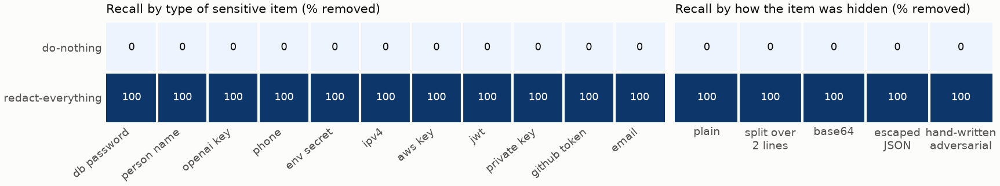
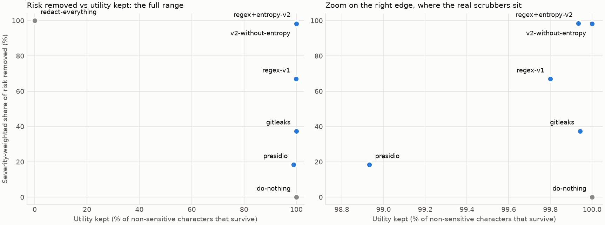

# trace-scrub-bench

A scrubber for AI coding-agent traces, & **ScrubBench**, a benchmark that scores any scrubber against a known answer key.

> All traces, secrets & personal data in this project are **synthetic**. Every secret carries the marker `FAKE`, phone numbers use the fictional 555-01xx block, IP addresses use private & documentation ranges, & email domains end in the reserved `.example` / `.test`. No generated data is committed: it is rebuilt from fixed seeds.

## 1. The question

**How much sensitive data do scrubbers miss in agent traces, which kinds slip through & how much useful content do they destroy along the way?**

## 2. Why it matters for AI training data

Agent traces (the logs of an AI coding agent's session) are valuable training data, but they are full of things that must not travel: API keys, database passwords, private keys, emails, names. Anyone who sells or shares traces has to scrub them first, & a scrubber that misses 2% of secrets in a million traces leaks thousands of them. On real traces nobody can measure that miss rate, because nobody knows what is hidden in them. So this project **plants** known secrets in synthetic traces & counts.

## 3. Method

**Plant, scrub, compare.**

1. **Generate** (`tracegen/`): a seeded generator writes coding-agent traces (reading files, running pytest, editing code, shell output) & plants 11 types of sensitive items at recorded positions: private keys, AWS keys, GitHub tokens, OpenAI-style keys, JWTs, database passwords, `.env` secrets, emails, phone numbers, personal names & IPv4 addresses. 30% of planted secrets are **hard cases**: split over two lines, base64-encoded, or inside JSON with escaped quotes. It also plants **decoys** that look sensitive but are not (UUIDs, commit hashes, documentation example keys, `127.0.0.1`).
2. **Scrub** (`scrubber/`): two versions of a scrubber. **v1** is one regex per type. **v2** adds a Shannon-entropy detector & fixes for what v1 missed, found on the dev split only.
3. **Score** (`bench/`): ScrubBench runs any scrubber through one interface, `scrub(text) -> str`, lines up the text before & after, & measures:
   - **recall**: share of planted items removed. Partial redaction is a miss: if more than 4 characters of an item survive, it leaked.
   - **severity-weighted score**: the same, weighted by how bad a leak is (private key & AWS key 10, tokens & passwords 7, email / phone / name 3, IP 1).
   - **precision**: of the characters removed, the share that was sensitive.
   - **utility kept**: share of non-sensitive characters that survive, plus two sharper checks: do **decoys** survive, & does **Python code still parse**?
   - **speed**: traces per second.

**Guard rails against fooling myself:**

- **Two baselines.** *do-nothing* (0% recall, 100% utility) & *redact-everything* (100% recall, 0% utility). Every real scrubber must land between them. The scorer is tested to give exactly these numbers.
- **Held-out test split.** v2 was tuned on a dev split (2,000 traces). All numbers below are from a test split with a different seed (1,000 traces), run once after every scrubber was frozen. Both splits are pinned by SHA-256 checksums in `bench/splits_v1.json`.
- **Hand-written adversarial traces.** 15 traces in formats the generator never produces (a token as hex, a JWT folded over three lines, `password=` outside a URL, obfuscated emails), written before any scrubber existed & never used for tuning.
- **Third-party entries.** [Gitleaks](https://github.com/gitleaks/gitleaks) (a secret scanner) & [Microsoft Presidio](https://github.com/microsoft/presidio) (a personal-data detector) run through the same interface.
- **The benchmark never imports the scrubber.** `bench/` loads entries by name from `bench/scrubbers.yaml`. A test enforces it.

Part A also includes the delivery tools a data seller needs: `scrubber/stats.py` (dataset statistics) & `scrubber/sample.py` (a stratified sampler that keeps the full set's mix of model × outcome × has-repo & writes a sample card).

## 4. Results

Held-out test split: 1,015 traces (1,000 generated + 15 hand-written), 3,423 planted items, 2,715 decoys, 6,287 Python files. Full tables: [`bench/LEADERBOARD.md`](bench/LEADERBOARD.md).

| scrubber | severity-weighted score | recall | precision | utility kept | decoys kept | Python still parses | adversarial recall | traces/sec |
|---|---|---|---|---|---|---|---|---|
| **regex+entropy-v2** (this repo) | 98.4% | 98.1% | 95.9% | 99.93% | 95.0% | 100.0% | 58.6% | ~120 |
| v2-without-entropy (ablation) | 98.2% | 98.0% | 100.0% | 100.00% | 100.0% | 100.0% | 51.7% | ~200 |
| **regex-v1** (this repo) | 67.0% | 68.1% | 85.8% | 99.80% | 56.5% | 100.0% | 17.2% | ~390 |
| gitleaks (third party) | 37.5% | 21.4% | 94.7% | 99.94% | 100.0% | 100.0% | 20.7% | ~22 |
| presidio (third party) | 18.4% | 34.5% | 13.3% | 98.93% | 75.1% | 41.0% | 24.1% | ~1.6 |
| do-nothing (baseline) | 0.0% | 0.0% | n/a | 100.00% | 100.0% | 100.0% | 0.0% | n/a |
| redact-everything (baseline) | 100.0% | 100.0% | 1.5% | 0.00% | 0.0% | 0.0% | 100.0% | n/a |





**The answer, in three parts.**

**How much do scrubbers miss?** The obvious scrubber, one regex per type, misses about a third: 31.9% of planted items & 33.0% of severity-weighted risk. After tuning, v2 misses 1.9% of the test split overall. Split by origin, that is 1.5% of the items in held-out generated traces (52 of 3,394) but **41% of the items in the hand-written traces** (12 of 29), whose formats it had never seen. That second number is the more honest estimate of what happens on unfamiliar data.

**Which kinds slip through?**
- v1 caught **none** of the secrets split over two lines, **none** of the base64-encoded ones, **none** of the personal names, & only 30% of `.env` secrets (it expected `NAME=value` at the start of a line) & 58% of OpenAI-style keys (its pattern stopped at the `-` in `sk-proj-...`).
- v2 closed those gaps on generated data. On the hand-written traces it still missed: a token printed as hex, a JWT folded over three lines, both obfuscated emails (`name [at] domain`, `%40`), all three non-US or digits-only phone numbers, an IP inside an AWS hostname (`ip-10-0-12-7`), a PGP private key, a password glued to `mysql -p...`, & two of three names in ordinary prose.
- The two third-party tools are specialists. Gitleaks removed 51.7% of secrets & no personal data (by design). Presidio removed 56.3% of personal data & 3.5% of secrets (by design). Presidio caught all three unusual phone formats that v2 missed.

**How much useful content do they destroy?** Measured by characters, almost nothing: every real scrubber keeps more than 98.9% of non-sensitive characters. That number hides real damage, which is why the sharper checks exist:
- v1 damaged **43.5% of the harmless decoys**: every loopback IP & version number, every `.env.example` placeholder, every `user@example.com`, & most documentation example keys.
- v2 keeps 95.0% of decoys. Its remaining damage is the entropy detector's false positive: half of the public base64 blobs (test image payloads such as `PNG_1X1 = "..."`) look exactly as random as a secret & get redacted.
- Presidio left only **41.0% of Python files parseable**, & only 13.3% of what it removed was sensitive: its name detector fires on ordinary identifiers in code.

**The trade-off, with the baselines as anchors:** redact-everything proves recall alone is meaningless (100% recall, 0% utility, 1.5% precision, because only 1.5% of all characters are sensitive). do-nothing proves utility alone is meaningless. A scrubber is only useful near the top right corner of the second plot.

**A result I did not expect: the entropy detector barely earns its place.** The `v2-without-entropy` row is v2 with that one detector switched off. On the test split it loses 0.1 points of recall (98.0% vs 98.1%) & gains everything v2 gives up in precision (100.0% vs 95.9%) & decoys (100.0% vs 95.0%). The rules that identify a secret by its variable name, or by decoding base64 & looking inside, already catch almost everything entropy catches, without the false positives. Entropy only pays off on unfamiliar formats: 17 of 29 adversarial items with it, 15 without (it caught a `gho_` token & a doubly base64-encoded token that no named rule knew). I left v2 as it was: the test split had already been run, & switching to the better-looking variant afterwards would be tuning on the test set.

**Two smaller findings.**
- A delivered sample is not automatically clean. Running the full pipeline (`make all`) scrubs 2,000 traces with v2 & draws a stratified sample of 200. Three `FAKE`-marked strings survive in that sample. With recall below 100%, a sample card should state the scrubber's measured miss rate, not claim the data is clean.
- The stratified sample matches the full set closely: 52.0% success rate vs 52.1%, 75.5% with a repo vs 75.9%, & no stratum off by more than 0.25 percentage points.

## 5. Limitations

- **The data is synthetic & template-based.** A few dozen templates stand in for the endless variety of real traces. Scores on the generated split are an upper bound, not an estimate for real data.
- **The same author wrote the generator, the adversarial traces & the scrubber.** v2 was tuned only on dev-split output, but it can't be blind to how the generator was designed. The 98.1% is flattered by that; the 58.6% on hand-written traces is closer to reality, & even those were written by the same person.
- **The adversarial set is tiny.** 29 items: one item is 3.4 percentage points. The 58.6% has a wide margin of error & no confidence interval is reported.
- **Synthetic safety markers change how third-party tools behave.** Presidio scored **0% on emails only because of this benchmark's reserved domains**: it rejects addresses whose top-level domain is not on the public list. With `.example` / `.test` swapped for `.com` / `.org` it removed 610 of 610 (`python -m bench.adapters.presidio_tld_check`). For the same reason it is charged with "damaging" decoys like `user@example.com`. Gitleaks may be affected by the `FAKE` marker in ways not measured here. The third-party rows are a fair comparison only for types these safety choices don't touch.
- **Presidio ran with spaCy's small English model**, not its default large one, so its name recall (58%) understates Presidio at its best.
- **"Utility kept" is a character count.** It says nothing about whether a scrubbed trace is still useful for training. Decoys kept & Python-still-parses are closer, but neither measures downstream value.
- **Scoring rests on a text alignment heuristic.** It works for scrubbers that replace spans with placeholders. A scrubber that rewrites or paraphrases text would be scored wrongly. The "more than 4 surviving characters = leaked" rule is a judgment call.
- **Severity weights (10 / 7 / 3 / 1) are judgment calls**, not derived from incident data.
- **Eleven types, English only.** Not covered: street addresses, dates of birth, payment cards, customer or account ids, internal hostnames & URLs, proprietary source code, non-Western name formats.
- **Speed is rough.** It was measured on one laptop CPU core while other jobs were running, & varied by up to 2× between runs. The Gitleaks adapter starts one process per trace, which dominates its time.
- **Model & harness names, & their success rates, are invented.** They say nothing about real systems.

## 6. What I'd try next

- **Plant into real traces.** Take public agent trajectories & insert the planted items into real content, so the surrounding text is no longer template-made.
- **A red-team adversarial set written by someone else**, & large enough (several hundred items) for confidence intervals, with bootstrap intervals on every leaderboard number.
- **Combine the specialists.** v2 for secrets, a named-entity model for names in prose, Presidio's phone recognizer for unusual formats. The case-by-case table suggests they miss different things.
- **Read Python as Python.** v2 reads JSON as JSON, which fixed every escaped-JSON miss. The same idea with Python's `ast` module would catch short secrets split across string literals.
- **A downstream utility test:** can a task still be replayed from its scrubbed trace?
- **An LLM-based scrubber as a leaderboard entry**, to see what it buys over regex & at what cost per trace.
- **Decide the entropy question properly:** with a larger adversarial set, measure whether the detector's gain on unfamiliar formats is worth its false positives, or whether it should only flag for human review.

## 7. How to run

```bash
conda create -n mlproj python=3.11 -y && conda activate mlproj
pip install -r requirements.txt
make all
```

`make all` runs the tests, generates the 2,000-trace dataset, prints its statistics, scrubs it with v2, draws a stratified sample with a sample card (`outputs/sample/`), rebuilds the benchmark splits, verifies their checksums & scores every registered scrubber into `bench/LEADERBOARD.md`. It takes about a minute.

The two third-party entries are optional & are skipped (with a note in the leaderboard) when they are not installed. The committed leaderboard was produced with both:

```bash
brew install gitleaks                                 # Gitleaks 8.30.1
pip install -r requirements-optional.txt              # Presidio 2.2.366
python -m spacy download en_core_web_sm
```

With Presidio installed, `make all` takes 15 to 20 minutes, nearly all of it Presidio. Other useful commands:

```bash
make bench-dev                                # score on the dev split while building a scrubber
python -m bench.misses --scrubber regex-v1    # what a scrubber missed & broke (dev split only)
make hooks                                    # switch on the pre-commit secret scan (needs gitleaks)
```

**Adding your own scrubber:** write a function `scrub(text: str) -> str` (or a command that reads stdin & writes stdout), add three lines to `bench/scrubbers.yaml`, run `python -m bench.run`.

## More

- [`EXPLAIN.md`](EXPLAIN.md): a plain-language, file-by-file walkthrough & answers to the hard questions about this project.
- [`BUILDLOG.md`](BUILDLOG.md): every step, decision & problem, including a bug in the benchmark itself that the first scrubber exposed.
- [`bench/LEADERBOARD.md`](bench/LEADERBOARD.md): all tables, including the adversarial traces case by case.

## Credits & license

MIT license. Third-party tools are installed separately & not redistributed here: [Gitleaks](https://github.com/gitleaks/gitleaks) (MIT), [Microsoft Presidio](https://github.com/microsoft/presidio) (MIT), [spaCy](https://spacy.io) (MIT).
