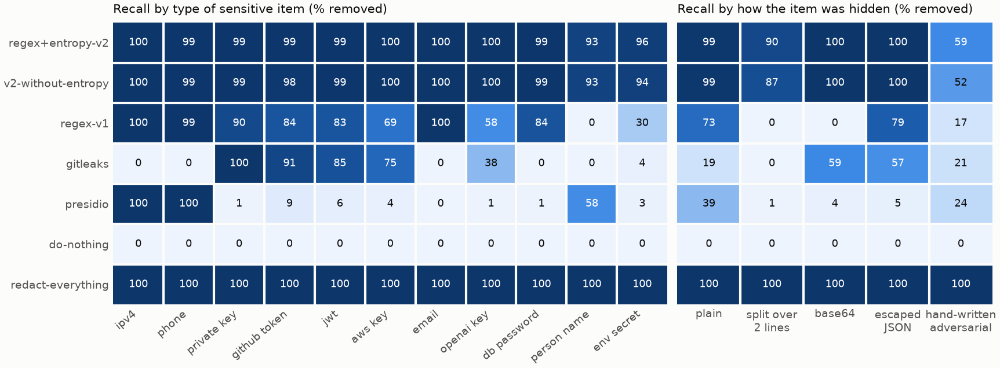

# ScrubBench leaderboard

Split: **test** (held out, plus hand-written adversarial traces). 1,015 traces, 3,423 planted sensitive items, 2,715 decoys, 6,287 Python files. All data is synthetic.

Regenerate with `python -m bench.run`. Every number except traces/sec is deterministic; speed depends on the machine.

| scrubber | balance | severity-weighted score | recall | precision | utility kept | decoys kept | Python still parses | adversarial recall | traces/sec |
|---|---|---|---|---|---|---|---|---|---|
| regex+entropy-v2 | 99.2% | 98.4% | 98.1% | 95.9% | 99.93% | 95.0% | 100.0% | 58.6% | 120 |
| v2-without-entropy | 99.1% | 98.2% | 98.0% | 100.0% | 100.00% | 100.0% | 100.0% | 51.7% | 200 |
| regex-v1 | 80.1% | 67.0% | 68.1% | 85.8% | 99.80% | 56.5% | 100.0% | 17.2% | 390 |
| gitleaks | 54.5% | 37.5% | 21.4% | 94.7% | 99.94% | 100.0% | 100.0% | 20.7% | 22 |
| presidio | 31.0% | 18.4% | 34.5% | 13.3% | 98.93% | 75.1% | 41.0% | 24.1% | 1.6 |
| do-nothing | 0.0% | 0.0% | 0.0% | n/a | 100.00% | 100.0% | 100.0% | 0.0% | 360,000 |
| redact-everything | 0.0% | 100.0% | 100.0% | 1.5% | 0.00% | 0.0% | 0.0% | 100.0% | 320,000 |

## How to read the columns

- **balance:** harmonic mean of the severity-weighted score & utility kept. It is high only when a scrubber removes the risk **and** keeps the content, so both baselines score 0. The table is sorted by it.
- **severity-weighted score:** share of risk removed, where each planted item counts by how bad its leak would be (private key 10, aws key 10, github token 7, openai key 7, jwt 7, db password 7, env secret 7, email 3, phone 3, person name 3, ipv4 1).
- **recall:** share of planted items removed. An item counts as removed only if at most 4 of its characters (& at most a quarter of it) survive: half a key is still a leaked key.
- **precision:** of all characters the scrubber removed, the share that was sensitive.
- **utility kept:** share of non-sensitive characters that survived.
- **decoys kept:** share of harmless look-alikes (UUIDs, commit hashes, documentation example keys, ...) left fully intact.
- **Python still parses:** share of Python files that are still valid Python after scrubbing.
- **adversarial recall:** recall on the hand-written traces only, in formats the generator never produces.
- **traces/sec:** scrubbing speed on one CPU core, scoring time excluded.

## Recall by type

| scrubber | aws key | db password | email | env secret | github token | ipv4 | jwt | openai key | person name | phone | private key |
|---|---|---|---|---|---|---|---|---|---|---|---|
| regex+entropy-v2 | 100% | 99% | 100% | 96% | 99% | 100% | 99% | 100% | 93% | 99% | 99% |
| v2-without-entropy | 100% | 99% | 100% | 94% | 98% | 100% | 99% | 100% | 93% | 99% | 99% |
| regex-v1 | 69% | 84% | 100% | 30% | 84% | 100% | 83% | 58% | 0% | 99% | 90% |
| gitleaks | 75% | 0% | 0% | 4% | 91% | 0% | 85% | 38% | 0% | 0% | 100% |
| presidio | 4% | 1% | 0% | 3% | 9% | 100% | 6% | 1% | 58% | 100% | 1% |
| do-nothing | 0% | 0% | 0% | 0% | 0% | 0% | 0% | 0% | 0% | 0% | 0% |
| redact-everything | 100% | 100% | 100% | 100% | 100% | 100% | 100% | 100% | 100% | 100% | 100% |

## Recall by how the item was hidden

| scrubber | adversarial | base64 | json escaped | plain | split |
|---|---|---|---|---|---|
| regex+entropy-v2 | 59% | 100% | 100% | 99% | 90% |
| v2-without-entropy | 52% | 100% | 100% | 99% | 87% |
| regex-v1 | 17% | 0% | 79% | 73% | 0% |
| gitleaks | 21% | 59% | 57% | 19% | 0% |
| presidio | 24% | 4% | 5% | 39% | 1% |
| do-nothing | 0% | 0% | 0% | 0% | 0% |
| redact-everything | 100% | 100% | 100% | 100% | 100% |

## Decoys kept, by kind

| scrubber | adversarial | b64 blob | doc example key | env placeholder | example email | git sha | safe ip | sha256 | uuid |
|---|---|---|---|---|---|---|---|---|---|
| regex+entropy-v2 | 80% | 50% | 100% | 100% | 100% | 100% | 100% | 100% | 100% |
| v2-without-entropy | 90% | 100% | 100% | 100% | 100% | 100% | 100% | 100% | 100% |
| regex-v1 | 60% | 100% | 28% | 0% | 0% | 100% | 0% | 100% | 100% |
| gitleaks | 100% | 100% | 100% | 100% | 100% | 100% | 100% | 100% | 100% |
| presidio | 90% | 98% | 100% | 100% | 0% | 96% | 0% | 97% | 99% |
| do-nothing | 100% | 100% | 100% | 100% | 100% | 100% | 100% | 100% | 100% |
| redact-everything | 0% | 0% | 0% | 0% | 0% | 0% | 0% | 0% | 0% |

## The hand-written adversarial traces, case by case

Items removed out of items planted. The last row holds only harmless look-alikes, so it shows how many were left intact.

| hand-written case | regex+entropy-v2 | v2-without-entropy | regex-v1 | gitleaks | presidio |
|---|---|---|---|---|---|
| query param | 1 of 1 | 1 of 1 | 1 of 1 | 0 of 1 | 0 of 1 |
| hex dump | 0 of 1 | 0 of 1 | 0 of 1 | 0 of 1 | 0 of 1 |
| new github formats | 2 of 2 | 1 of 2 | 0 of 2 | 2 of 2 | 0 of 2 |
| aws temporary credentials | 2 of 2 | 2 of 2 | 0 of 2 | 1 of 2 | 0 of 2 |
| other key headers | 1 of 2 | 1 of 2 | 1 of 2 | 2 of 2 | 0 of 2 |
| wrapped jwt | 0 of 1 | 0 of 1 | 0 of 1 | 0 of 1 | 0 of 1 |
| database credentials without a url | 2 of 3 | 2 of 3 | 0 of 3 | 0 of 3 | 0 of 3 |
| unusual secret names | 3 of 3 | 3 of 3 | 0 of 3 | 0 of 3 | 0 of 3 |
| python repr | 1 of 1 | 1 of 1 | 0 of 1 | 0 of 1 | 0 of 1 |
| double base64 | 1 of 1 | 0 of 1 | 0 of 1 | 1 of 1 | 0 of 1 |
| obfuscated emails | 0 of 2 | 0 of 2 | 0 of 2 | 0 of 2 | 0 of 2 |
| phone formats | 0 of 3 | 0 of 3 | 0 of 3 | 0 of 3 | 3 of 3 |
| ip shapes | 2 of 3 | 2 of 3 | 2 of 3 | 0 of 3 | 2 of 3 |
| names in prose | 2 of 4 | 2 of 4 | 1 of 4 | 0 of 4 | 2 of 4 |
| harmless lookalikes | 8 of 10 kept | 9 of 10 kept | 6 of 10 kept | 10 of 10 kept | 9 of 10 kept |

## Notes on individual entries

- **gitleaks:** Gitleaks is a secret scanner. It has no rules for emails, phone numbers, IP addresses or names, so its 0% on those four types is by design, & its overall recall should be read next to its recall on secrets only.
- **presidio:** Presidio's 0% on emails is an artifact of this benchmark, not of Presidio. Every synthetic email here ends in a reserved top-level domain (.example or .test) so it can never belong to a real person, & Presidio rejects addresses whose top-level domain is not on the public list. With the endings swapped for .com / .org, Presidio removed 610 of 610 test-split emails (python -m bench.adapters.presidio_tld_check). For the same reason it "damages" the example-email decoys such as user@example.com. Its name detection uses the small spaCy model.

## Entries

- **regex+entropy-v2:** This repo's scrubber, version 2. Regex + entropy + fixes found on the dev split.
- **v2-without-entropy:** Ablation. Version 2 with its entropy detector switched off, to show what that detector adds & costs.
- **regex-v1:** This repo's scrubber, version 1. One regex per type.
- **gitleaks:** Third party. Gitleaks 8 secret scanner with its default rules; findings are replaced by a placeholder.
- **presidio:** Third party. Microsoft Presidio for emails, phones, IPs & names, with spaCy's small English model.
- **do-nothing:** Baseline. Returns the text unchanged.
- **redact-everything:** Baseline. Replaces the whole text with one block character.
