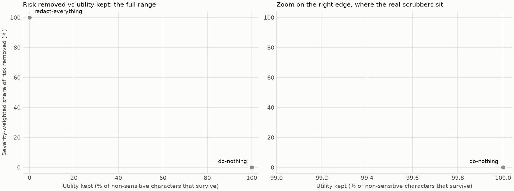

# ScrubBench leaderboard

Split: **test** (held out, plus hand-written adversarial traces). 1,015 traces, 3,423 planted sensitive items, 2,715 decoys, 6,287 Python files. All data is synthetic.

Regenerate with `python -m bench.run`. Every number except traces/sec is deterministic; speed depends on the machine.

| scrubber | balance | severity-weighted score | recall | precision | utility kept | decoys kept | Python still parses | adversarial recall | traces/sec |
|---|---|---|---|---|---|---|---|---|---|
| do-nothing | 0.0% | 0.0% | 0.0% | n/a | 100.00% | 100.0% | 100.0% | 0.0% | 210,000 |
| redact-everything | 0.0% | 100.0% | 100.0% | 1.6% | 0.00% | 0.0% | 0.0% | 100.0% | 51,000 |

## How to read the columns

- **balance:** harmonic mean of the severity-weighted score & utility kept. It is high only when a scrubber removes the risk **and** keeps the content, so both baselines score 0. The table is sorted by it.
- **severity-weighted score:** share of risk removed, where each planted item counts by how bad its leak would be (private key 10, aws key 10, github token 7, openai key 7, jwt 7, db password 7, env secret 7, email 3, phone 3, person name 3, ipv4 1).
- **recall:** share of planted items removed. An item counts as removed only if at most 4 of its characters (& at most a quarter of it) survive: half a key is still a leaked key.
- **precision:** of all characters the scrubber removed, the share that was sensitive.
- **utility kept:** share of non-sensitive characters that survived.
- **decoys kept:** share of harmless look-alikes (UUIDs, commit hashes, documentation example keys, ...) left fully intact.
- **Python still parses:** share of Python files that are still valid Python after scrubbing.
- **adversarial recall:** recall on the hand-written traces only, in formats the generator never produces.
- **traces/sec:** scrubbing speed on one CPU core, scoring time excluded.

## Recall by type

| scrubber | aws key | db password | email | env secret | github token | ipv4 | jwt | openai key | person name | phone | private key |
|---|---|---|---|---|---|---|---|---|---|---|---|
| do-nothing | 0% | 0% | 0% | 0% | 0% | 0% | 0% | 0% | 0% | 0% | 0% |
| redact-everything | 100% | 100% | 100% | 100% | 100% | 100% | 100% | 100% | 100% | 100% | 100% |

## Recall by how the item was hidden

| scrubber | adversarial | base64 | json escaped | plain | split |
|---|---|---|---|---|---|
| do-nothing | 0% | 0% | 0% | 0% | 0% |
| redact-everything | 100% | 100% | 100% | 100% | 100% |

## Decoys kept, by kind

| scrubber | adversarial | b64 blob | doc example key | env placeholder | example email | git sha | safe ip | sha256 | uuid |
|---|---|---|---|---|---|---|---|---|---|
| do-nothing | 100% | 100% | 100% | 100% | 100% | 100% | 100% | 100% | 100% |
| redact-everything | 0% | 0% | 0% | 0% | 0% | 0% | 0% | 0% | 0% |

